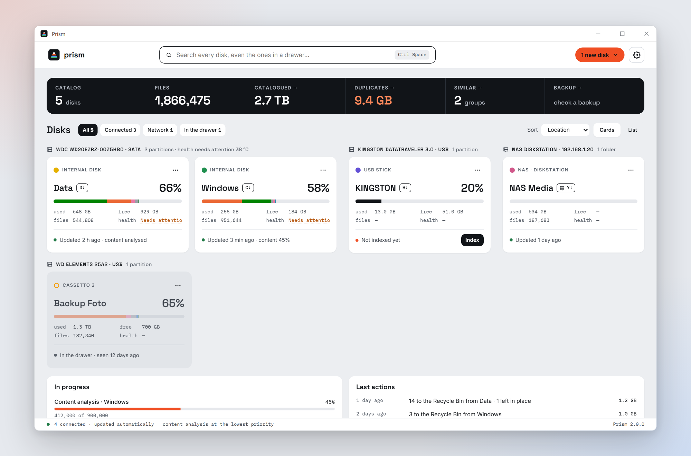
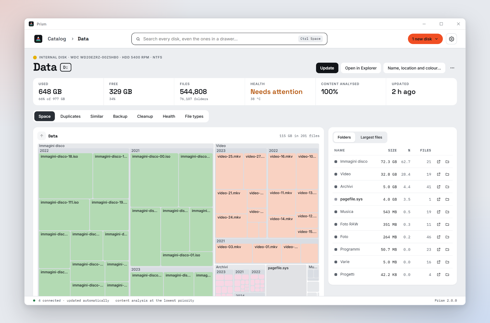
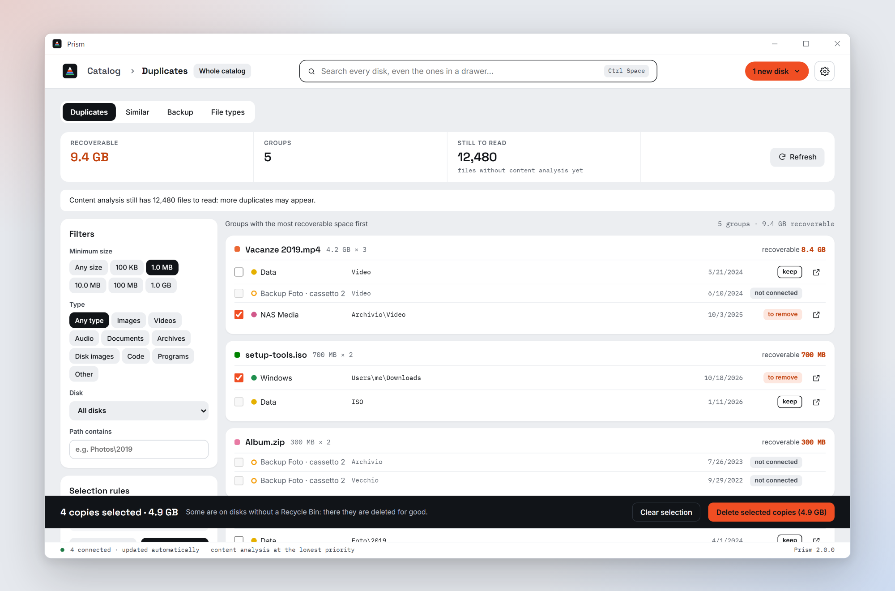
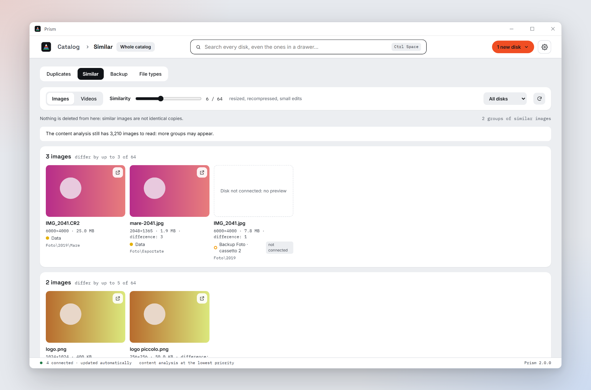
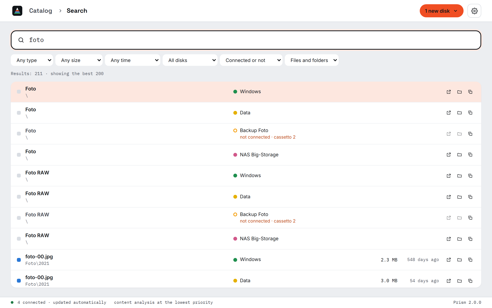
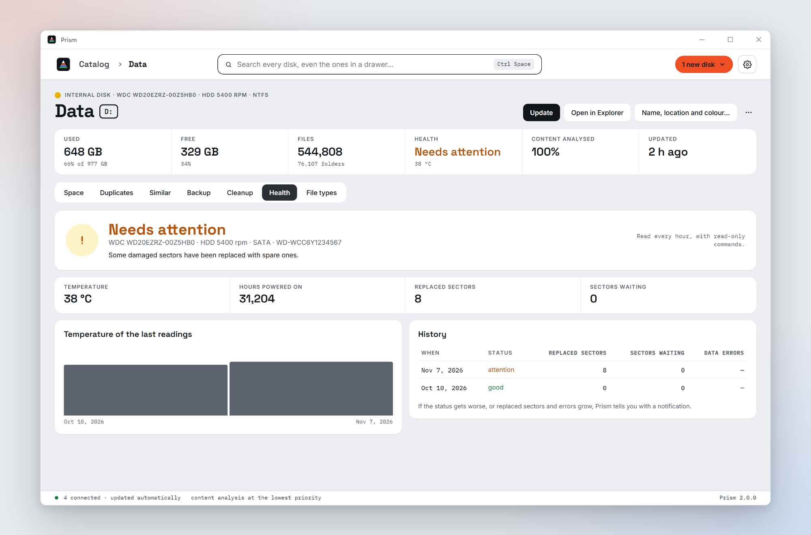
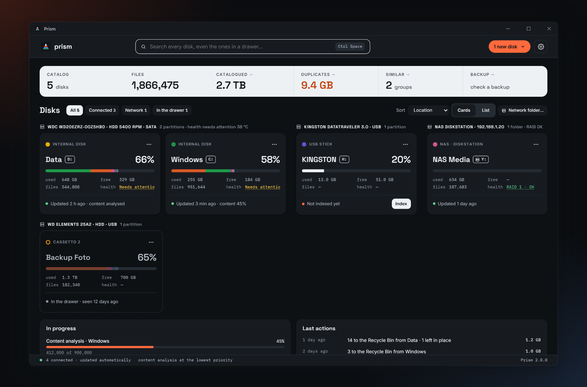

# Prism

**A catalog of all your disks for Windows — even the disconnected ones.**

Prism indexes every drive you own (internal, external, USB sticks, network shares) and keeps
the catalog available when the drive is unplugged. On top of the catalog it offers instant
search, disk-space analysis, exact and similar duplicates, backup verification and disk
health monitoring.

> **Download:** the installer is in the
> [latest release](https://github.com/caste9612/Prism/releases/latest); installed copies update
> themselves. Prism 2.0 is the new Prism, rewritten from scratch; releases 1.0.0 and 1.0.1 are
> the previous version, which 2.0 replaces.



## What Prism does

- **Disks** — every disk you connect appears in the catalog and is indexed in the background
  (NTFS volumes are read through the Master File Table: about a million files in a few
  seconds). Name the disk, note where it is kept, give it a colour. Disconnected disks stay in
  the catalog with the data of their last indexing, and Prism recognizes a disk even when its
  drive letter changes. The partitions of one physical disk, and the folders of one NAS, are
  shown together.
- **Network folders** — shares of a NAS or of another PC, with or without a drive letter. If the
  NAS gets another address from the router, Prism finds the folder again by the NAS name (and
  asks before changing the catalog), or you give it the new address.
- **Search** — `Ctrl+Space` from anywhere opens the search window. Results come from all
  disks, connected or not, as you type; filters for type, size, date, disk, connected or not,
  files or folders (e.g. `report size:>1MB ext:pdf`).
- **Space** — a map of what takes space on a disk or folder, the largest files and statistics
  by file type, also for disconnected disks.
- **Cleanup** — space you can recover on the connected disks (temporary files, caches, empty
  folders, large old files), with a confirmation before anything is removed.
- **Duplicates** — identical files across all your disks and NAS folders, found by content.
  Prism analyses the content in the background, at the lowest priority (a NAS one folder at a
  time); in *Settings* you can pause it, also only while on battery, or leave a disk out.
- **Similar** — photos, pictures and videos that look the same even if resized, re-encoded or
  slightly retouched, side by side.
- **Backup** — check that the files of a disk or folder have a copy somewhere else, compare two
  disks or folders, and copy what is missing (every copy is read back and verified).
- **Health** — the SMART data of your disks (temperature, wear, errors), with a notice when a
  disk gets worse.
- **Explorer menu** — right-click a folder or a drive: *Analyze with Prism* and *Find
  duplicates here*.

Prism runs in the notification area: closing the window keeps it working in the background;
*Quit* in the menu of its icon closes it.

| | |
|---|---|
|  |  |
| **Space** of a disk, folder by folder | **Duplicates** across all disks, connected or not |
|  |  |
| **Similar** pictures, side by side | **Search** on every disk, even in a drawer |
|  |  |
| **Health** of a disk, with its history | Light and dark theme |

The screenshots show the simulated catalog used to develop the interface: the disks and files in
them are invented (`npm --prefix ui run screens` takes them again).

## Your files are safe

- Nothing is deleted, moved or overwritten without your explicit confirmation.
- Deleted files go to the Recycle Bin unless you choose otherwise, and Prism checks every file
  again on the disk right before removing it: if it changed since the analysis, it is skipped.
- A duplicate is never deleted if it is the only copy left, nor if it is, on the disk, the same
  file as a copy you keep (a hard link, or one NAS disk shown in two shared folders).
- Copies never overwrite an existing file and are verified by reading them back.
- Prism only reads your disks to build the catalog.

## Installation

Requirements: Windows 11, 64-bit.

1. Run `Prism_<version>_x64-setup.exe` from the
   [latest release](https://github.com/caste9612/Prism/releases/latest). The installer is not
   code-signed yet: if Windows SmartScreen says "Windows protected your PC", choose *More info ›
   Run anyway*.
2. Windows asks for administrator permission: Prism is installed for every user of the PC and
   needs the permission to read the Master File Table and the change journal of NTFS disks,
   which makes indexing and updates fast, and the health data of the disks.
3. If the Microsoft Edge WebView2 runtime is missing, the installer downloads it.
4. Prism starts with Windows, hidden in the notification area, without asking for permission
   each time (a scheduled task with the highest privileges). You can turn this off in
   *Settings*.

The interface is in English and Italian (it follows Windows; you can change it in
*Settings*), with a light and a dark theme.

## Updates

Prism checks for a new version one minute after starting and then once a day. A new version
is downloaded in the background; *Settings › Updates* shows it, and it is installed only when
you choose *Install and restart*. Packages are signed, and a package with a wrong signature is
never installed.

## Privacy

- No telemetry. The only connection Prism makes is the update check.
- The catalog stays on your PC, in `%LOCALAPPDATA%\com.prism.catalog` (the logs, kept for 14
  days, are in its `logs` folder).
- A diagnostic package is created only when you ask for it (*Settings › Diagnostics*); you see
  its content before saving it, and it is up to you whether to send it to anyone.

## Known limitations

- Videos in HEVC (H.265) format are compared only if Windows has the *HEVC Video Extensions*
  from the Microsoft Store.
- Analysing a network folder reads its files through the network: a large NAS takes hours the
  first time (one folder of a NAS at a time; you can leave a folder out in *Settings*).
- A NAS folder that shows the NAS's other folders inside it (some NAS systems have one) is
  counted twice; index the data folders instead.
- Disks connected by USB often do not pass their health data to Windows.

## Uninstall

Use *Settings › Apps › Installed apps › Prism › Uninstall*. The Explorer menu entries and the
start-up task are removed. The uninstaller asks whether to delete the application data: leave
the box empty to keep the catalog, and a new installation will find it again.

## Built with

Rust (a core crate for the catalog, indexing, search and analysis; a Windows crate for the
Master File Table, the change journal, SMART, the Recycle Bin and Media Foundation), SQLite,
Tauri 2 and Svelte 5. Content hashes with BLAKE3, perceptual prints of pictures and videos.

## Documentation

| Document | Content |
|---|---|
| [docs/SPEC.md](docs/SPEC.md) | Functional specification with acceptance criteria |
| [docs/ARCHITECTURE.md](docs/ARCHITECTURE.md) | System architecture |
| [docs/adr/](docs/adr/README.md) | Architecture decision records |
| [docs/TESTING.md](docs/TESTING.md) | Test strategy and data-safety rules |
| [docs/ROADMAP.md](docs/ROADMAP.md) | Milestones |
| [docs/PROGRESS.md](docs/PROGRESS.md) | Development log |
| [docs/REVIEW.md](docs/REVIEW.md) | Decisions taken during development, open items, how to try the app |
| [docs/benchmarks/](docs/benchmarks/README.md) | Performance measurements |
| [docs/releases/](docs/releases/) | Release notes |

Project documents are written in Italian.

## Development

Requirements: Windows 11 x64, Rust (the version is pinned in `rust-toolchain.toml`), Node.js
for the interface.

```powershell
.\scripts\check.ps1             # format check, clippy, tests (Rust, interface, end-to-end)
.\scripts\build-installer.ps1   # release build and signed installer (see ARCHITECTURE §8.1)
npm --prefix ui run dev         # the interface in a browser, with a simulated catalog
```

Releases are published from GitHub Actions (*Actions › Release*), with the approval of the
maintainer.
