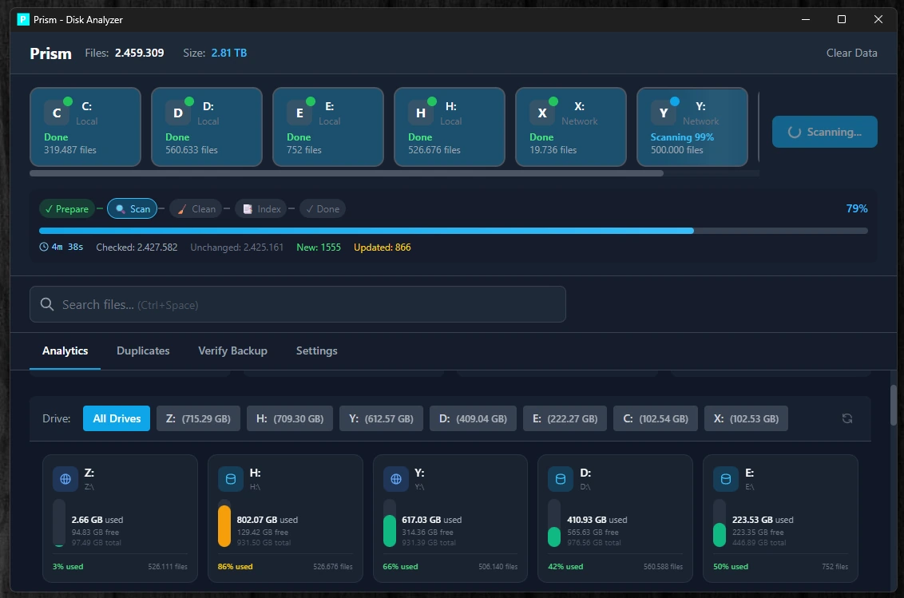
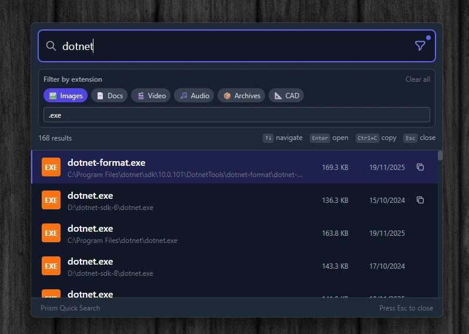
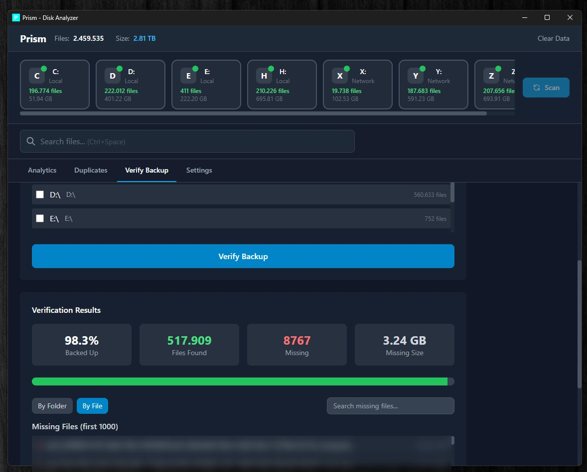

# Prism

**A disk analyzer and duplicate finder for Windows.**

[](https://github.com/caste9612/Prism/releases/latest)

[](LICENSE)

With many drives, local and on the network, I didn't know where the space went, which files were duplicates
and whether a backup really held everything. Prism indexes the drives once and then only what changes. It
shows the space as a treemap, finds duplicates by content and compares a drive with its backup, listing what
is missing.



## Download

Download `Prism.exe` from the [latest release](https://github.com/caste9612/Prism/releases/latest) and run it:
Prism is portable, there is nothing to install.

- **Windows** with WebView2, which comes with Windows 11.
- The index is a local SQLite database in `%APPDATA%\com.prism.diskanalyzer\`; the logs are in
  `%LOCALAPPDATA%\Prism\logs`.

## What it does

**Scanning**
- Local and network drives are scanned in parallel; after the first pass only the changed files are read
  again. On the author's PC that is about 25,000–30,000 files a second on a local SSD and 500–1,000 on a
  network drive.
- At startup Prism rescans only the drives it already knows, and a drive monitor queues them again when they
  come back online.

**Search**
- Full-text search over the index (SQLite FTS5), with filters that can be typed:

  | Filter | Example | Finds |
  |---|---|---|
  | `size:` | `size:>100MB` | files larger than 100 MB |
  | `ext:` | `ext:pdf,docx` | these extensions |
  | `type:` | `type:image` | a category: image, video, audio, document, archive |
  | `path:` | `path:Documents` | paths that contain the text |

- **Quick Search** opens from anywhere with `Ctrl+Space`, with buttons for the file types.



**Duplicates**
- Duplicate files found by content hash (BLAKE3, first a partial hash, then the full one) and similar images
  by perceptual hash, with the space each group wastes and deletion in batches, after a confirmation.

**Space usage**
- A folder tree and an interactive treemap of the space in use, with the distribution by file type and
  extension.

**Backup check**
- Checks whether every file on one drive is also on another, and lists the missing ones grouped by folder,
  with their size and a search box.



The complete guide is in [docs/FEATURES.md](docs/FEATURES.md).

## Build from source

```bash
git clone https://github.com/caste9612/Prism.git
cd Prism
npm install
npm run tauri dev      # development, with hot reload
npm run tauri build    # release build
```

You need Node 18 or later, Rust 1.75 or later and the
[Tauri prerequisites](https://tauri.app/start/prerequisites/). Tests: `npm run check`, `npm test` and
`cargo test`.

The design is in [docs/ARCHITECTURE.md](docs/ARCHITECTURE.md), the Tauri commands and events in
[docs/API.md](docs/API.md), the setup and the conventions in [docs/DEVELOPMENT.md](docs/DEVELOPMENT.md), the
version history in [docs/CHANGELOG.md](docs/CHANGELOG.md).

Built with Tauri 2, SvelteKit, TypeScript, Tailwind CSS and D3.js on the front end, and Rust with jwalk,
rayon, rusqlite and blake3 behind it.

## License

[MIT](LICENSE)
