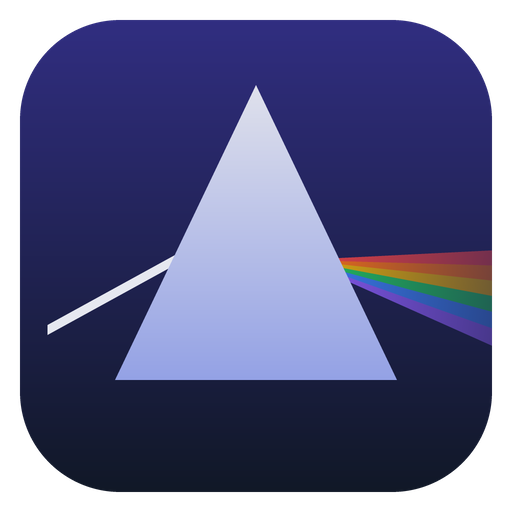

<div align="center">
  
  <h1>Prism</h1>
  <strong>The catalog of all your disks for Windows — even the ones in a drawer</strong>
  <br /><br />
  <a href="https://github.com/caste9612/Prism/releases/latest"></a>
  
  
  
  
</div>

Prism keeps a **catalog of every disk you own** — internal disks, external drives, USB sticks,
the folders of your NAS — and keeps it **when the disk is unplugged**. Search all of them at
once, see what takes space, find duplicates and similar pictures across disks, check that your
backups really have a copy, and keep an eye on the health of your disks.

> Prism is **not** a backup or sync program: it never copies, moves or deletes anything on its
> own. It is the catalog that tells you what you have and where it is — and it acts on your files
> only when you ask, with every safeguard on.


---

## Why Prism

- **It remembers the disks you unplug.** Every disk you connect is indexed once and stays in the
  catalog: you can search it, browse its folders and see what takes space while it sits in a
  drawer. Give it a name, a colour and the place where you keep it, and Prism tells you where to
  find a file.
- **It is fast on real disks.** NTFS disks are read through the Master File Table: 1.26 million
  files and folders in 5.7 seconds, then kept up to date from the change journal. A search over
  millions of names answers while you type.
- **It never risks your files.** Nothing is deleted without your confirmation, deleted files go
  to the Recycle Bin, and every file is checked again on the disk right before it is touched.
- **It stays out of the way.** It lives in the notification area, `Ctrl+Space` opens the search
  from anywhere, and the background analysis runs at the lowest priority.

### Principles (non-negotiable)

1. **Your files are safe** — only explicit, confirmed actions; Prism only reads your disks to
   build the catalog.
2. **Disconnected disks are first-class** — everything that can work from the catalog works
   without the disk.
3. **Private** — no telemetry, no account; the only connection is the update check.

---

## Install

Download the latest version from the [releases page](https://github.com/caste9612/Prism/releases/latest):

| System | File | How |
|---|---|---|
| Windows 11, 64-bit | `Prism_X.Y.Z_x64-setup.exe` | Run it and accept the administrator request |

- The installer is **not code-signed yet**: if Windows SmartScreen says "Windows protected your
  PC", choose *More info › Run anyway*.
- Prism is installed for every user of the PC and runs with administrator rights: it needs them
  to read the Master File Table, the change journal and the health data of the disks. It starts
  with Windows, hidden in the notification area, through a scheduled task, so there is no
  permission prompt at each sign-in (*Settings* turns it off).
- If the Microsoft Edge WebView2 runtime is missing, the installer downloads it.
- Prism then **updates itself** from the releases: a new version is downloaded in the
  background and installed when you choose *Install and restart*. Packages are signed, and one
  with a wrong signature is never installed.

---

## Features

**Disks & catalog**
- Every connected disk appears in the catalog, with a proposal to index it; disks you never want
  to see can be ignored. Disks are recognised by their identity, not their letter, so a disk
  that comes back as `F:` instead of `E:` is still the same disk.
- **Grouped as they are**: the partitions of one physical disk sit together under its model,
  connection and health; the folders of one NAS under its name and address.
- **Name, location and colour** for each disk — "Photos 2019, drawer 2" — shown on its card and
  in every search result.
- **Network folders** of a NAS or another PC, with or without a drive letter. If the router gives
  the NAS another address, Prism finds the folders again by the NAS name and asks before changing
  the catalog; or you give it the new address, checked against the catalog first.
- Updates by themselves: NTFS disks from the change journal while Prism runs, every other disk
  (exFAT, FAT, network) from a folder watcher, and any disk when it comes back.

**Search**


- `Ctrl+Space` from anywhere opens the search window; results come from every disk, connected or
  not, as you type.
- Filters in the text or from the controls: type, size, date, disk, connected or not, files or
  folders — `report size:>1MB ext:pdf modified:2024`.
- Open the file, show it in Explorer or copy its path from the keyboard; a file on a disk in a
  drawer says which disk and where it is kept.

**Space & cleanup**


- A **map** of what takes space on a disk or folder, folder by folder, with the largest files and
  statistics by file type — also for disks that are not connected.
- **Guided cleanup** of the connected disks: temporary files, caches, empty folders, large old
  files, each category explained, everything to the Recycle Bin after a confirmation.

**Duplicates & similar**


- **Identical files** across all your disks and NAS folders, found by content (BLAKE3), with the
  space you would recover. Rules propose which copies to remove — keep the oldest, the one on a
  given disk, the shortest path — and you change them freely.
- One copy always stays, and Prism refuses to delete a "copy" that is, on the disk, the same file
  as one you keep (a hard link, or one NAS disk shown in two shared folders).
- **Similar pictures and videos** — resized, re-encoded or slightly retouched — side by side, with
  RAW photos read from their embedded preview. Nothing is deleted from there.


- The content is analysed in the background at the lowest priority, a NAS one folder at a time;
  pause it, pause it on battery, or leave a disk out.

**Backup**
- Check that the files of a disk or folder have a copy somewhere else — by content when it is
  known, so a renamed copy counts — even against a backup disk in a drawer.
- Compare two disks or folders, then **copy what is missing**: the folder structure is kept,
  nothing is overwritten, and every copy is read back and verified.

**Health**


- SMART data of SATA and NVMe disks: status, temperature, hours, wear, replaced sectors, errors,
  with a history and a notification when a disk gets worse.

**Windows**
- Notification area icon with the analysis pause and *Quit*; closing the window keeps Prism
  working.
- Explorer menu on folders and drives: *Analyze with Prism* and *Find duplicates here*.
- A notification when a new disk is connected while the window is hidden.
- English and Italian (following Windows), light and dark theme (following Windows), a
  diagnostic package you see before saving.


---

## Your files are safe

- Nothing is deleted, moved or overwritten without your explicit confirmation.
- Deleted files go to the Recycle Bin unless you choose otherwise; where there is none (USB
  sticks, network folders) Prism says so and asks again.
- Every file is checked again on the disk right before it is removed: if it changed since the
  analysis, it is skipped and reported. Every action is recorded in *Last actions*.
- Copies never overwrite an existing file and are verified by reading them back.

---

## Footprint

Measured on a Ryzen 9 7950X with an NVMe SSD (details in [docs/benchmarks](docs/benchmarks/README.md)):

| Item | Measure |
|---|---|
| Installer | ~6.1 MB |
| Indexing an NTFS disk through the Master File Table | 1.26 million entries in 5.7 s; 620,000 in 2.1 s |
| Indexing a NAS folder over the network | 2,000–3,000 entries per second |
| Catalog on disk | ~120 bytes per file or folder (5.7 million entries: 656 MiB) |
| Search | 1.37 million names: the first 1,000 results in under 1 ms |
| Memory | ~325 MiB with 5.7 million entries in the catalog, search index included |
| Picture prints for similar images | ~66 photos per second with 4 threads |

---

## Stack & key decisions

- **Rust + Tauri 2** (the system WebView2), **not** Electron → a small installer and no bundled
  browser.
- **Svelte 5 + Vite + TypeScript**, **not** SvelteKit → a single-window app needs no router or
  server rendering.
- **The NTFS Master File Table and change journal**, **not** a walk of the folders → indexing in
  seconds and updates without rescanning; other file systems and network folders use a parallel
  walker.
- **SQLite** for the catalog with an **in-memory search index**, **not** SQLite's full-text
  search → substring search in milliseconds without doubling the size of the catalog.
- **BLAKE3 in three passes** — a quick hash of the files whose size repeats, then the full hash of
  the candidates, then the rest — so duplicates appear early.
- **Perceptual prints** (difference hash) for pictures; video frames decoded by Windows **Media
  Foundation**, **not** a bundled ffmpeg.
- **tauri-plugin-updater** with minisign-signed installers published by a GitHub Actions workflow,
  approved by the maintainer.

The workspace: `prism-core` (catalog, indexing, search, analysis), `prism-win` (Master File
Table, change journal, SMART, Recycle Bin, Media Foundation, notifications), `prism-app` (the
Tauri app), `prism-shell` (the Explorer menu helper) and `prism-cli` (a development tool). The
design is in [docs/ARCHITECTURE.md](docs/ARCHITECTURE.md) and the decisions in
[docs/adr](docs/adr/README.md) and [docs/REVIEW.md](docs/REVIEW.md).

---

## Keyboard shortcuts

| Key | Action |
|---|---|
| `Ctrl+Space` | Open the search from anywhere (can be changed in *Settings*) |
| `↑` / `↓` | Move through the search results |
| `Enter` | Open the selected result |
| `Shift+Enter` / `Ctrl+Enter` | Show the selected result in Explorer |
| `Ctrl+C` | Copy the path of the selected result |
| `Esc` | Close the search window |

---

## Privacy

- No telemetry. The only connection Prism makes is the update check.
- The catalog stays on your PC, in `%LOCALAPPDATA%\com.prism.catalog`; the logs, kept for 14 days,
  are in its `logs` folder.
- A diagnostic package is created only when you ask for it (*Settings › Diagnostics*); you see
  its content before saving it, and it is up to you whether to send it to anyone.

## Known limitations

- Videos in HEVC (H.265) format are compared only if Windows has the *HEVC Video Extensions*
  from the Microsoft Store.
- Analysing a network folder reads its files through the network: a large NAS takes hours the
  first time.
- A NAS folder that shows the NAS's other folders inside it (some NAS systems have one) is
  counted twice; index the data folders instead.
- Disks connected by USB often do not pass their health data to Windows.

## Uninstall

*Settings › Apps › Installed apps › Prism › Uninstall*. The Explorer menu entries and the start-up
task are removed. The uninstaller asks whether to delete the application data: leave the box
empty to keep the catalog, and a new installation finds it again.

---

## Development

Requirements: Windows 11 x64, Rust (the version is pinned in `rust-toolchain.toml`), Node.js
24 for the interface.

```powershell
npm --prefix ui ci
npm --prefix ui run dev          # the interface in a browser, with a simulated catalog
.\scripts\check.ps1              # format, clippy, Rust tests, interface tests, end-to-end tests
```

## Build & release

```powershell
.\scripts\build-installer.ps1 -NoUpdateSignature   # an installer to try, in target\release\bundle\nsis
```

Releases are published by the **Release** workflow on GitHub Actions
(`.github/workflows/release.yml`), started by hand on `develop`: it builds the installer signed
with the update key, kept in the secrets of a protected `release` environment that waits for the
maintainer's approval, and publishes it with `latest.json` for the updater. The release notes
come from `docs/releases/<version>.md`.

```powershell
gh workflow run release.yml --ref develop                   # dry run: the files stay in the run's artifact
gh workflow run release.yml --ref develop -f publish=true   # GitHub release
```

The whole procedure, and how to keep the update key, are in
[docs/ARCHITECTURE.md §8.1](docs/ARCHITECTURE.md).

## Test

```powershell
.\scripts\check.ps1                 # everything required before a commit
npm --prefix ui run e2e:real        # the end-to-end check on the real app (docs/TESTING.md §4bis)
npm --prefix ui run screens         # the screenshots of this README, from the simulated catalog
```

The screenshots show the simulated catalog used to develop the interface: its disks and files are
invented. Project documents ([docs/](docs/)) are written in Italian.

## License

[MIT](LICENSE)
